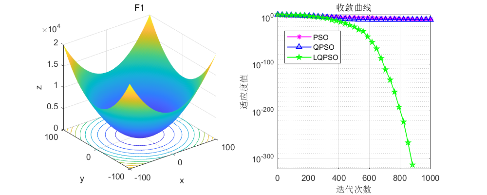
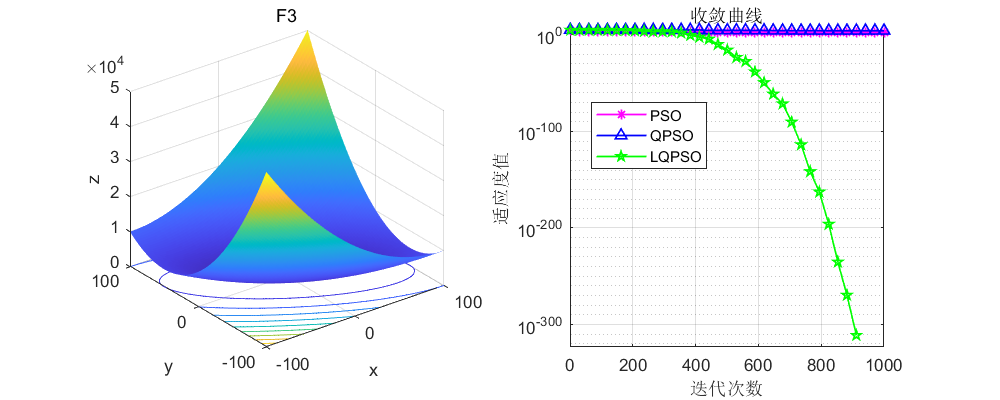
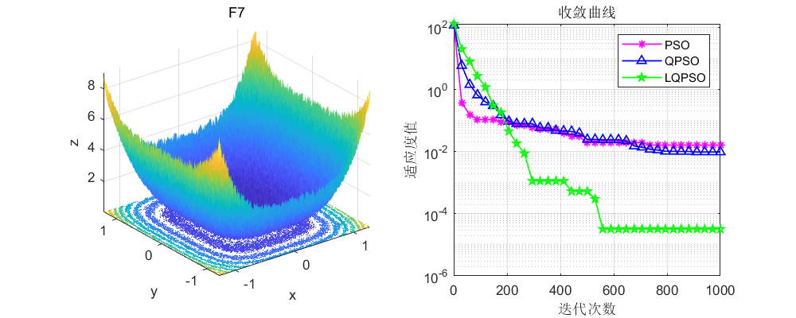
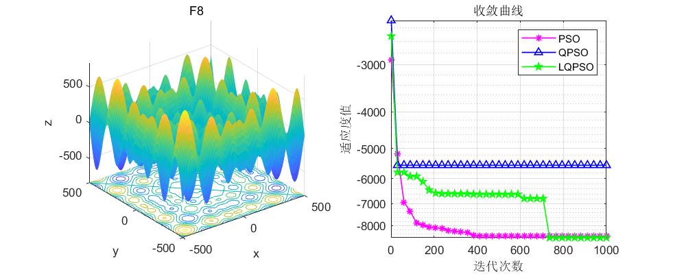
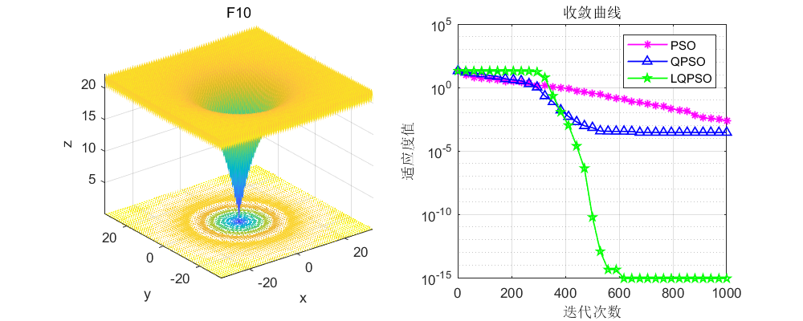
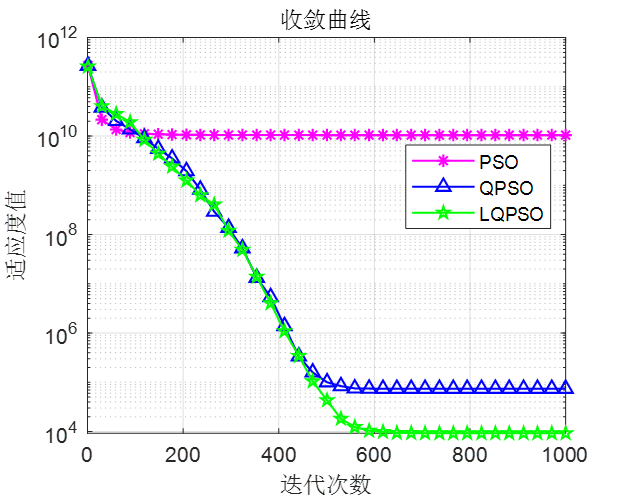
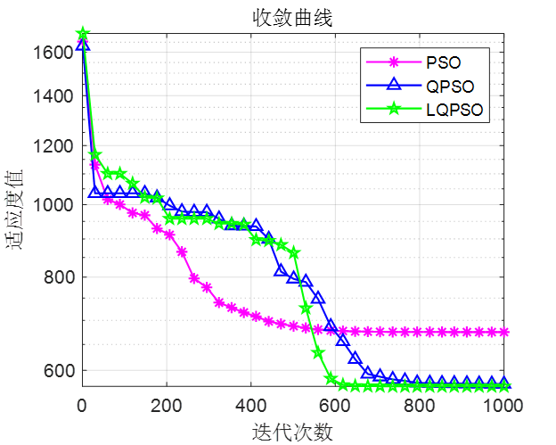
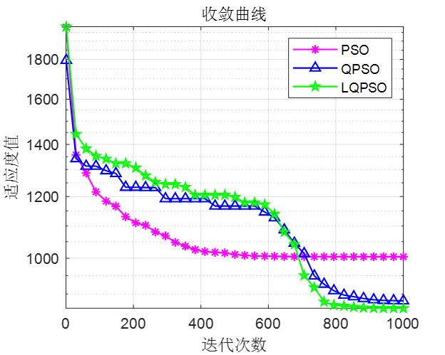
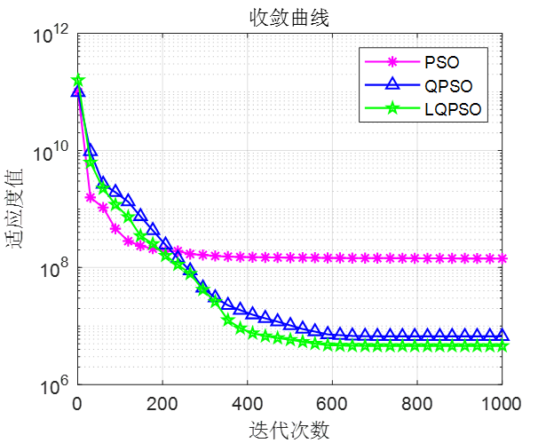
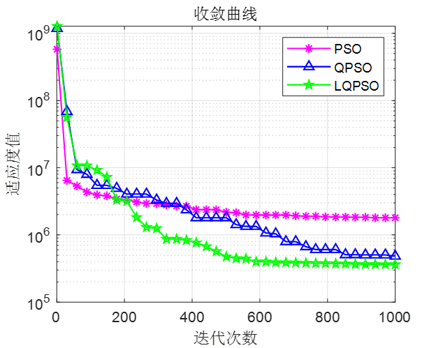

# Quantum Particle Swarm Algorithm based on Levy Flight, running on CEC2005 and CEC2017 functions.

Today, I bring you a smart optimization algorithm: Quantum Particle Swarm Optimization based on Levy Flight.
The original intention of writing this code was to receive a message from a back-end colleague asking for the quantum particle swarm optimization to run on the CEC2017 function. After completing the code, it was discovered that although the performance of the quantum particle swarm optimization had slightly improved compared to the original particle swarm optimization, the improvement was minimal. Thinking that publishing an article just to satisfy everyone might be too lazy, so---the author added Levy Flight into the quantum particle swarm optimization and found that the results were quite good.
Here's something to note, which also came from a researcher (and a close friend) (who could publish two papers in SCI A journal during his master's degree, relying solely on himself without relying on others) after learning and communicating with me: In some high-level papers, CEC2005 and CEC2017 are often used as test functions to verify intelligent algorithms. These two functions have the most classic test sets, with CEC2005 being used more frequently than CEC2017. This article is packed in one go, and all the codes are already written in the code.
Firstly, let's look at the results, starting with the CEC2005 function set tests, where QPSO is the quantum particle swarm optimization, and LQPSO is the quantum particle swarm optimization based on Levy Flight. Select a few functions randomly:
This effect, developed on top of the particle swarm optimization, is indeed quite good.
Then, let's take a look at the test results on the CEC2017 function set, select a few functions randomly:
F1
\n        \n  
F5  
F8  
F12  
F18  
From the test results on the CEC2017 function, the LQPSO algorithm is not significantly different from the QPSO algorithm. However, compared to the original PSO algorithm, it still shows significant improvement.  
The code directory has been organized, and two sets of functions are included in the code, including LQPSO, QPSO, and PSO.  
Code:
clear\nclc\nclose all\naddpath(genpath(pwd));\nfunc_num=12;   % Modify the function\nD=50;\nlb=-100;\nub=100;\nN=100;   %Population number\nT=1000;   % Iteration count\nfhd=str2func('cec17_func');\n\n%% PSO\n[fMin , bestX,PSO_Convergence_curve ] =PSO(fhd,func_num,N,T,lb,ub,D);\ndisplay(['The best optimal value of the objective funciton found by PSO  for ' [num2str(func_num)],'  is : ', num2str(fMin)]);\nfprintf ('Best solution obtained by PSO: %s\n', num2str(bestX,'%e  '));\n\n%% QPSO\n[Best_score,Best_pos,QPSO_curve]=QPSO(fhd,func_num,N,T,lb,ub,D);  % Calculating the solution of the given problem using PSO\ndisplay(['The best optimal value of the objective funciton found by QPSO  for ', [num2str(func_num)],'  is : ', num2str(Best_score)]);\nfprintf ('Best solution obtained by QPSO: %s\n', num2str(Best_pos,'%e  '));\n\n%% LQPSO\n[LBest_score,LBest_pos,LQPSO_curve]=QPSO(fhd,func_num,N,T,lb,ub,D);  % Calculating the solution of the given problem using PSO\ndisplay(['The best optimal value of the objective funciton found by QPSO  for ', [num2str(func_num)],'  is : ', num2str(LBest_score)]);\nfprintf ('Best solution obtained by QPSO: %s\n', num2str(LBest_pos,'%e  '));\n%Draw objective space\n %% Figure\nfigure1 = figure('Color',[1 1 1]);\nCNT=35;\nk=round(linspace(1,T,CNT)); % Randomly select CNT points\n% Note: If the number of points drawn on the convergence curve is small, and the random points are sparse, it indicates that the number of points has been insufficient. At this time, the number of points should be increased gradually, such as 100, 200, 300, etc.\n% On the contrary, if the random points on the convergence curve are very dense, it indicates that too many points have been taken. At this time, the number of points should be reduced.\niter=1:1:T;\nsemilogy(iter(k),PSO_Convergence_curve(k),'m-*','linewidth',1);\nhold on\nsemilogy(iter(k),QPSO_curve(k),'b-^','linewidth',1);\nhold on\nsemilogy(iter(k),LQPSO_curve(k),'g-p','linewidth',1);\ngrid on;\ntitle('Converging curve')\nxlabel('Iteration count');\nylabel('Fitness value');\nbox on\nlegend('PSO','QPSO','LQPSO')\nset (gcf,'position', [300,300,400,320])\nCode Description:   
① Code adopts quantum behavior to improve particle swarm algorithm
② Code adopts Levy flight and quantum behavior to improve particle swarm algorithm

## Images

<!-- PAYMENT_BLOCK -->

## Get this dataset

- Payment link (Stripe): [Buy now](https://buy.stripe.com/3cs8yP7sY87d0vu9AB)
- Payment QR code: 

<!-- /PAYMENT_BLOCK -->
